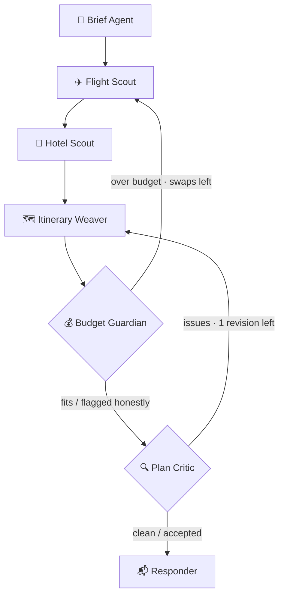

# Holiday Planner AI with LangGraph

*The world is waiting — tell it where you're going, in your own words.*

**Live demo:** https://holiday-planner-ai-8jfa.onrender.com (Render free tier — first load after idle takes ~1 minute)

An open-source AI travel planner that turns a natural-language trip request
into a practical plan — flight suggestions, hotel ideas matched to your
vibe, and a day-by-day itinerary — built as a **multi-agent LangGraph
workflow** behind a FastAPI web app with a travel-journal interface.

> “Plan a 5-day foodie trip from Chicago to Paris next month, budget $2,500
> for 2 people” → a full plan: Delta DL149 at $428/person, a Saint-Germain
> boutique at $142/night, five days of eating your way through Paris, and a
> total of **$2,408 against the $2,500 budget** — after the Budget Guardian
> revised the plan twice to get it under the line. (Real output; see
> [`docs/examples/`](docs/examples/).)

## Meet the crew

| Agent | Job |
|---|---|
| 🧭 **Brief Agent** | Parses your words into a structured brief — origin, destination, dates, travelers, budget, vibe. Deterministic rule parser by default (city gazetteer, date/duration phrasing, budget & vibe extraction); a Groq structured-output parse is attempted first when `GROQ_API_KEY` is set, with automatic fallback. |
| ✈️ **Flight Scout** | Returns 3 flight options and a recommended pick (value-scored, or cheapest when the Guardian asks). |
| 🏨 **Hotel Scout** | Returns 3 hotels matched to your vibe and the nightly budget your trip can carry. |
| 🗺️ **Itinerary Weaver** | Builds the day-by-day plan from vibe-tagged activity banks, respecting flight times — a late landing means a light first day, and departure day has no evening plans. |
| 💰 **Budget Guardian** | Totals flights + hotel + daily spend. Over budget? It issues swap instructions (cheaper flight → cheaper hotel → trimmed paid activities, max 2 revisions) and loops the crew back. Still over? It flags it honestly — numbers are never fudged. |
| 🔍 **Plan Critic** | Proofreads for clashes: activities before the flight lands, overstuffed days (>3 paid), empty days. One revision loop, then it accepts and reports. |
| 📬 **Responder** | Composes the final plan with picks, alternates, the budget breakdown, and a transparent note trail of everything the crew did. |



## Quickstart

```bash
python3 -m venv .venv
.venv/bin/pip install -r requirements.txt
.venv/bin/uvicorn holidayplanner.app:app --reload
```

Open <http://127.0.0.1:8000>, describe a trip, and watch the crew work.
Every plan is saved under a trip ID and can be re-fetched at
`/api/trips/{thread_id}`.

**API**

| Endpoint | What it does |
|---|---|
| `GET /` | Travel-journal home page with the trip form and sample requests |
| `POST /plan` | Form endpoint — renders the full plan page |
| `POST /api/plan` | JSON in `{"request": "...", "thread_id": "optional"}` → JSON plan |
| `GET /api/trips/{thread_id}` | Fetch a previously saved plan |
| `GET /health` | `{"status": "ok"}` |

## Providers: simulated by default, live when keyed

No keys are needed to run, demo, test, or evaluate the project — the
simulated engines are deterministic (same request → same plan), which is
what makes the test suite and golden-trip eval reproducible.

| Capability | Default | Live option | Notes |
|---|---|---|---|
| Brief parsing | Rule-based parser | `GROQ_API_KEY` → LangChain-Groq (`llama-3.3-70b-versatile`, structured output) | Any LLM failure falls back to the rule parser |
| Flights | Simulated (distance-based duration/fare model) | `AVIATIONSTACK_API_KEY` → AviationStack API | AviationStack publishes no fares, so prices are estimated and flagged; errors fall back to simulated |
| Hotels | Simulated (per-city banks + price index) | `TAVILY_API_KEY` → Tavily search | Names from search results, nightly rates estimated and flagged; errors fall back to simulated |
| Persistence | SQLite at `data/holidayplanner.db` | `DATABASE_URL=postgres://…` → PostgreSQL (same schema, needs `psycopg[binary]`) | LangGraph state itself is checkpointed in-memory per `thread_id` |

## Screenshots — the artwork

The interface is a warm travel journal (cream paper, deep-navy ink,
mustard gold) built around three supplied illustrations, which ship in
`holidayplanner/static/img/` and appear as the home-page hero, the
“The world is waiting” gallery, and the plan-page header:

| Artwork | Where it appears |
|---|---|
| `art-1.jpg` — traveler & globe, dusk navy/cream | Plan-page header; gallery |
| `art-2.jpg` — cartoon plane & landmark globe | Gallery |
| `art-3.jpg` — globe & landmarks, deep navy | Home-page hero; gallery |

## Tests & evaluation

```bash
.venv/bin/python -m pytest -q        # 33 tests: parser, providers, agents, graph, API, store
.venv/bin/python evals/run_eval.py   # 10 golden trips with brief + invariant checks
```

The eval (`evals/golden_trips.json`) runs 10 requests through the full
graph and verifies the parsed brief plus plan invariants: correct day
count, nothing scheduled before the flight lands, no empty or overstuffed
days, and honest budget math (`ok` ⇒ total ≤ budget; `flagged` ⇒ total >
budget). CI (`.github/workflows/ci.yml`) runs both on Python 3.12.

## What ran where (honest notes)

- **Exercised locally:** the full LangGraph workflow, rule parser,
  simulated flight/hotel engines, SQLite persistence, the FastAPI UI and
  JSON API (live server run; real outputs in `docs/examples/`), the
  33-test suite, and the 10-case eval — all passing.
- **Implemented but not exercised locally:** the Groq brief-parsing path,
  the AviationStack and Tavily adapters (no API keys in the sandbox; both
  are covered by tests that verify their fallback behavior), and
  PostgreSQL persistence (no Postgres server in the sandbox — same schema,
  via optional `psycopg`).
- Simulated flights/hotels are realistic fabrications from distance and
  city price models, clearly labeled `simulated` in every plan's notes.

## License

MIT © 2026 Sravanthi Panga
